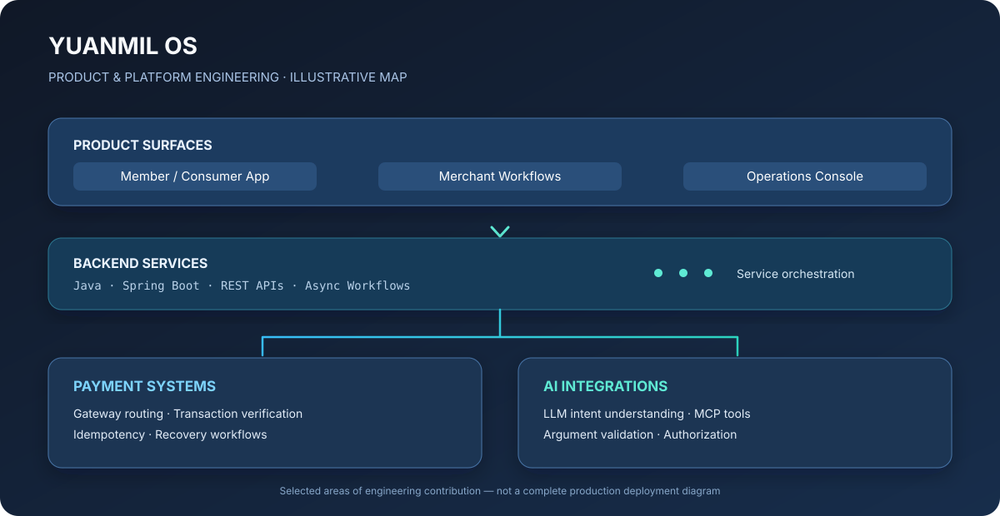
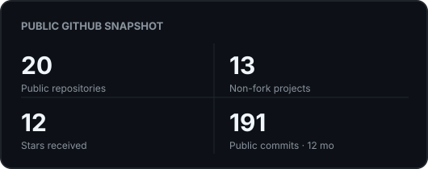

  
   
  <strong>Computer Science @ Drew University · Mathematics Minor</strong>
   
  
  
  

---

## About Me

I'm a Computer Science undergraduate at Drew University. As part of **YuanMil (元禧)'s early founding engineering team**, I design and build across merchant products, payment infrastructure, internal operations systems, and AI integrations. My work spans architecture and hands-on implementation—from transaction verification and recovery to full-stack business workflows and LLM/MCP tool integrations. I also build and release browser extensions and developer tools.

## 🚀 What I'm Shipping

<table>
  <tr>
    <td width="50%" valign="top">
      <h3>元禧 OS · YuanMil</h3>
      
      
<strong>Released iOS product · Platform engineering</strong>

      
Working across the product ecosystem behind member and merchant experiences, operations tooling, backend services, payment workflows, and AI integrations.

      
<a href="https://apps.apple.com/cn/app/%E5%85%83%E7%A6%A7os/id6795852285">App Store</a> · <a href="docs/yuanmil-engineering-overview.md">Engineering case study</a>

      
Vue 3 · uni-app · React · Java · Spring Boot · Redis/Lua · MCP

    </td>
    <td width="50%" valign="top">
      <h3>SakuraMeter</h3>
      
      
<strong>Released Chrome extension · Developer productivity</strong>

      
Tracks ChatGPT activity and Codex usage windows, reset times, and experimental public reset forecasts. Also includes Side Chat and an experimental browser agent.

      
<a href="https://chromewebstore.google.com/detail/hnajkeiigdkgafcobbkchpcdafddfpki">Chrome Web Store</a> · <a href="https://github.com/YinL-k/chatgpt-codex-usage-reset-tracker/releases">Releases</a> · <a href="https://github.com/YinL-k/chatgpt-codex-usage-reset-tracker">Source</a>

      
TypeScript · Chrome Extension APIs · Browser automation · Local-first data

    </td>
  </tr>
</table>

## Selected Projects

<table>
  <tr>
    <td width="50%" valign="top">
      <h3><a href="https://github.com/YinL-k/google-skills-learning-agent">Google Skills Learning Agent</a></h3>
      
      
Guarded browser-automation prototype for reading course/lab pages, extracting visible state, validating safe next actions, and maintaining learning notes.

      TypeScript · Browser automation · Safety checks
    </td>
    <td width="50%" valign="top">
      <h3><a href="https://github.com/YinL-k/web-launch-console">Web Launch Console</a></h3>
      
Windows control panel for launching web apps, managing related processes, checking service health, viewing logs, and optionally creating Cloudflare Quick Tunnels.

      PowerShell · WPF · Node.js · Process management
    </td>
  </tr>
  <tr>
    <td width="50%" valign="top">
      <h3><a href="https://github.com/YinL-k/vector-fields-project">Interactive Vector Fields</a></h3>
      
Interactive 2D/3D vector addition and vector-field demonstrations, including particle motion visualizations built with JavaScript and Three.js.

      <a href="https://yinl-k.github.io/vector-fields-project/3D%20Field.html">Open live 3D field demo</a>
    </td>
    <td width="50%" valign="top">
      <h3><a href="https://github.com/YinL-k/synchronized-scrolling-reader">Synchronized Scrolling Reader</a></h3>
      
A browser-based two-pane code/text reader with synchronized scrolling, local file loading, syntax highlighting, and light/dark themes.

      <a href="https://github.com/YinL-k/synchronized-scrolling-reader">View repository</a>
    </td>
  </tr>
</table>

## Engineering Experience

### YuanMil (元禧) · Founding Engineer — Platform, Payments & AI

*Aug–Nov 2026*

Part of the early engineering team building YuanMil's merchant products, internal operations tools, backend services, payment workflows, and AI capabilities.

- **Payment architecture & reliability:** Designed and implemented gateway/account routing, transaction verification, idempotency, and recovery mechanisms for collection, refund, and settlement-related workflows. Built automated checks using simulated payment-channel responses.
- **AI systems & access control:** Developed LLM-based intent understanding and structured tool selection, with MCP/business API integrations, argument validation, authorization checks, and OAuth 2.0 / PKCE-related work.
- **Full-stack platform engineering:** Built Vue 3 / uni-app / TypeScript merchant features, React operations interfaces, and Java / Spring Boot backend APIs.
- **Business workflows & delivery:** Worked on merchant/store operations, orders, member/distributor experiences, asynchronous processing, cross-module coordination, regression tests, and deployment documentation.

[YuanMil engineering case study](docs/yuanmil-engineering-overview.md) — payment design, AI integration, architecture, and implementation details.

## Applied ML Research

### DiscoveryHub · Drew Summer Science Institute (DSSI)

*Summer 2026 · Semantic retrieval and embedding evaluation*

Contributed to a research project matching research interests with university technology-transfer listings and patent records.

- Prepared heterogeneous records and query–document pairs for retrieval experiments.
- Fine-tuned and evaluated **Qwen3-Embedding-0.6B** and **multilingual-e5-large**.
- Used **Recall@k**, **MRR@10**, and ranking-based evaluation; documented the limitations of proxy research-interest data.

*Research repository is private.*

## Open-Source Contributions

Selected pull requests merged into other open-source projects:

- **[Pixiv-Shaft #1309](https://github.com/CeuiLiSA/Pixiv-Shaft/pull/1309)** — improved filename truncation by Unicode code point and capped extension length.
- **[Pixiv-Shaft #1310](https://github.com/CeuiLiSA/Pixiv-Shaft/pull/1310)** — preserved one-based page numbering semantics for legacy import templates.
- **[whyfull #19](https://github.com/amlaban65/whyfull/pull/19)** — added repeatable exclude paths for full scans.

## Languages & Tools

**Additional engineering work:** REST APIs · SQL · Payment gateways & idempotency · Redis/Lua · OAuth 2.0 / PKCE · MCP · Browser extensions · CI / release checks

### AI-Assisted Development

  
  &nbsp;&nbsp;
  
  &nbsp;&nbsp;
  

  Claude Code · OpenAI Codex · ChatGPT

I use these tools to help build and review software; changes are checked against code and tests.

## GitHub Activity

Updated by [GitHub Actions](.github/workflows/profile-metrics.yml). Contribution counts use GitHub's publicly visible profile data (including anonymous private activity if enabled); language breakdowns reflect public code bytes.

---

**Building useful products and reliable systems at the intersection of platform engineering, payments, and applied AI.**

[Explore all repositories](https://github.com/YinL-k?tab=repositories)

