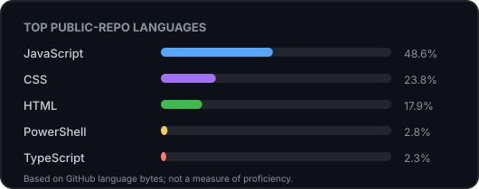

# Xianzhuo (Ari) Yin

**Software Engineering · AI Systems · Full-Stack Product Development**

Computer Science @ Drew University · Mathematics Minor

*Building practical software products, developer tools, and AI-enabled workflows.*

## About Me

I build software across the stack—from product and interface design to backend integrations, AI tool orchestration, testing, and delivery. I worked with the early founding team of **Yuanmil (元禧)** on a multi-application platform, and I also build independently released browser extensions and developer tools.

I am interested in **Software Engineer** and **AI Engineer** roles where I can turn complex requirements into reliable, usable systems.

## Engineering Experience

### Yuanmil (元禧) · Early Founding Team — Product & Full-Stack Engineering

Worked across product design and engineering on a platform spanning consumer-facing experiences, merchant tools, operational interfaces, backend services, and AI integrations.

- **Full-stack applications:** Implemented and integrated features involving a **Vue 3 / uni-app / TypeScript** merchant application, **React** operations interfaces, and **Java / Spring Boot** business APIs.
- **AI tool orchestration:** Worked on AI Concierge flows combining LLM reasoning, structured tool selection, runtime validation, protected backend integrations, and responses grounded in trusted business data.
- **MCP & authorization:** Contributed to MCP integration, OAuth consent flows, scoped access controls, administration, and audit capabilities.
- **Business systems:** Worked on merchant/store operations, order workflows, customer support, member/distributor experiences, and payment-related integration paths.
- **Reliability & delivery:** Contributed to access-control boundaries, regression tests, release preflight checks, deployment documentation, and cross-module handoffs.
- **Product & UX:** Translated business workflows and design references into application features across interfaces and services.

*The company repositories are private. This description is intentionally high-level and does not publish proprietary source code, business records, or internal designs. Implementation, verification, and production-release status differ across features.*

## Featured Projects

| Project | What I Built |
| --- | --- |
| **[SakuraMeter](https://github.com/YinL-k/chatgpt-codex-usage-reset-tracker)** | Released Chrome extension for ChatGPT activity and Codex usage monitoring, with optional Side Chat and experimental structured-action browser Agent. [Chrome Web Store](https://chromewebstore.google.com/detail/hnajkeiigdkgafcobbkchpcdafddfpki). |
| **[Google Skills Learning Agent](https://github.com/YinL-k/google-skills-learning-agent)** | Guarded TypeScript browser-automation prototype for extracting lab state, evaluating potential actions, and maintaining learning notes. |
| **[Web Launch Console](https://github.com/YinL-k/web-launch-console)** | PowerShell/Node.js tool for launching web services, managing process lifecycles, viewing logs, running health checks, and optionally opening a temporary tunnel. |
| **[Interactive Vector Fields](https://github.com/YinL-k/vector-fields-project)** | Interactive 2D/3D mathematical visualizations using JavaScript and Three.js. |
| **[Synchronized Scrolling Reader](https://github.com/YinL-k/synchronized-scrolling-reader)** | Browser-based side-by-side code/text viewer with synchronized scrolling, syntax highlighting, and themes. |
| **[Pixiv Bookmark Random](https://github.com/YinL-k/Pixiv-Bookmark-Random)** | Chrome Manifest V3 extension using buffering, preloading, and state management for bookmark navigation. |

## Applied ML Research

### DiscoveryHub · Drew Summer Science Institute (DSSI)

Contributed to a semantic retrieval pipeline matching research interests with university technology-transfer listings and patent records.

- Prepared heterogeneous datasets and query–document training/evaluation pairs.
- Fine-tuned and evaluated **Qwen3-Embedding-0.6B** and **multilingual-e5-large**.
- Analyzed retrieval performance using **Recall@k**, **MRR@10**, and rank-based measures.
- Documented limitations of proxy research-interest data.

*Research repository is private.*

## Languages & Tools

### AI-assisted Development Tools

  
  &nbsp;&nbsp;
  
  &nbsp;&nbsp;
  

  Claude Code · OpenAI Codex · ChatGPT

I use AI-assisted development tools for planning, implementation, debugging, and code review, with generated changes verified through source inspection, tests, and appropriate release checks.

**Engineering interests:** LLM tool calling · agent runtimes · MCP · semantic search · browser automation · full-stack products · engineering reliability

## GitHub Activity

Charts are refreshed daily by [GitHub Actions](.github/workflows/profile-metrics.yml). The contribution calendar reads the **publicly visible GitHub profile calendar**, not individual repositories. It includes anonymized private contributions **only if** [Private contributions](https://docs.github.com/en/account-and-profile/how-tos/contribution-settings/manage-visibility-settings-for-private-contributions-and-achievements) is enabled under the profile's Contribution settings. GitHub may show the account owner more contributions than a public visitor. No private code, repository names, commit messages, or credentials are accessed. Language percentages reflect public repository code bytes, not proficiency.

---

**Interested in software engineering, applied AI, and building useful products.**

[Explore my repositories](https://github.com/YinL-k?tab=repositories)

