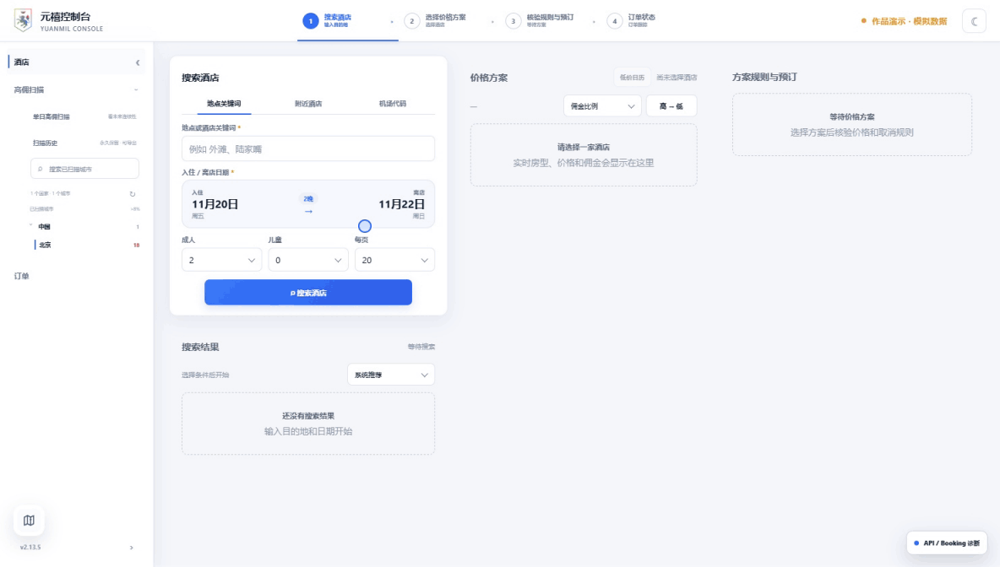
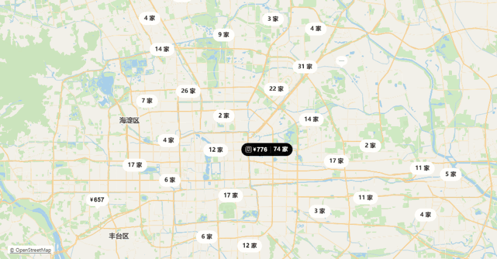

  
  

    <a href="https://www.linkedin.com/in/xianzhuo-yin-602562331/">LinkedIn</a> ·
    <a href="https://apps.apple.com/cn/app/%E5%85%83%E7%A6%A7os/id6795852285">YuanMil OS</a> ·
    <a href="https://chromewebstore.google.com/detail/hnajkeiigdkgafcobbkchpcdafddfpki">SakuraMeter</a> ·
    <a href="https://github.com/YinL-k?tab=repositories">Repositories</a>
  

I build and lead software across multi-surface products, payment infrastructure, and applied AI. I combine technical direction with hands-on engineering—from backend architecture and integrations to product interfaces and retrieval systems.

**Co-Founder & CTO @ YuanMil** · **Computer Science @ Drew University** · **Mathematics Minor**

## Featured Products

<table>
  <tr>
    <td width="50%" valign="top">
      
      <h3>YuanMil OS · 元禧</h3>
      
<strong>Co-Founder & CTO · Hospitality technology</strong>

      
A multi-surface hospitality platform spanning an iOS app, WeChat Mini Program, merchant workflows, operations tools, and shared backend services.

      
<strong>My work:</strong> Platform architecture and hands-on engineering across payment infrastructure, Java / Spring services, AI/MCP integrations, and OAuth 2.0 / PKCE authorization.

      
<a href="https://apps.apple.com/cn/app/%E5%85%83%E7%A6%A7os/id6795852285">App Store</a> · <a href="https://yuanmilos.com/">Website</a> · <a href="docs/yuanmil-engineering-overview.md">Engineering case study</a>

      
Java · Spring Boot · Vue 3 · uni-app · React · Redis/Lua · MCP

    </td>
    <td width="50%" valign="top">
      
      <h3>SakuraMeter</h3>
      
<strong>Creator & Developer · Chrome extension</strong>

      
A browser extension for ChatGPT activity insights and Codex usage visibility, featuring Side Chat and browser-agent workflows.

      
<a href="https://chromewebstore.google.com/detail/hnajkeiigdkgafcobbkchpcdafddfpki">Chrome Web Store</a> · <a href="https://github.com/YinL-k/chatgpt-codex-usage-reset-tracker">Source code</a> · <a href="https://github.com/YinL-k/chatgpt-codex-usage-reset-tracker/releases">Releases</a>

      
TypeScript · Chrome Extension APIs · Browser automation · Local-first data

    </td>
  </tr>
</table>

## YuanMil — Selected Engineering Work

### YuanMil Business Operations · 元禧经营宝

  <em>Product walkthrough GIF in progress — placeholder for the upcoming demo.</em>

**Sole Developer · Independent end-to-end product development**

Independently developed YuanMil Business Operations, a standalone WeChat Mini Program for merchants and individual distributors. I owned the client-side product implementation using **Vue 3, uni-app, and TypeScript**, including its integration with YuanMil's shared Java / Spring services.

- **Merchant operations:** Store, staff, and role-aware workflows.
- **Business workflows:** Order management, order verification, product management, and store operations.
- **Financial workflows:** Settlement management, distributor commissions, and payout-related experiences.
- **Platform integration:** Connected merchant and distributor experiences to shared YuanMil backend capabilities.

Vue 3 · uni-app · TypeScript · Java / Spring APIs

### High-Commission Hotel Search & Operations Console

  

**Sole Developer · Independent product design and development**

Independently designed and built this hotel operations console from product concept through implementation. It brings together map-based hotel discovery, multi-date availability and rate comparison, cancellation-policy review, and high-commission opportunity analysis in one workflow.

### YuanMil OS · 元禧

**Co-Founder & CTO · Platform engineering contributor**

Contributed to the broader YuanMil OS platform through technical direction and hands-on engineering across payment infrastructure, shared backend services, AI integrations, and internal operations tooling.

- **Payment architecture:** Designed and implemented collection, refund, and settlement-related workflows, including gateway and account routing, transaction verification, idempotency, and recovery.
- **AI Concierge & MCP:** Built LLM-based intent understanding and structured tool execution, with application-side argument validation and authorization checks.
- **Identity and access:** Contributed to OAuth 2.0 Authorization Code with PKCE and scoped access controls for integrations.
- **Platform services:** Worked across Java / Spring business APIs and internal operations tooling supporting multiple product surfaces.

[App Store](https://apps.apple.com/cn/app/%E5%85%83%E7%A6%A7os/id6795852285) · [Website](https://yuanmilos.com/) · [Engineering case study](docs/yuanmil-engineering-overview.md)

Java · Spring Boot · Vue 3 · uni-app · React · Redis/Lua · MCP · OAuth 2.0 / PKCE

## Applied AI & Research

### DiscoveryHub · Drew Summer Science Institute (DSSI), Summer 2026

Built the query-side data and semantic-retrieval fine-tuning pipeline for matching pharma-side research-interest text with university technology-transfer listings and patent records.

- **26,648 normalized records:** 6,671 AUTM/TTO listings, 9,977 ClinicalTrials.gov records, and 10,000 USPTO patent records.
- **10,006 evaluation anchors** with query-document pairs, corpus records, relevance labels, and hard negatives.
- Fine-tuned and evaluated **Qwen3-Embedding-0.6B** and **multilingual-e5-large**.

| Embedding model | Recall@10: baseline → tuned | MRR@10: baseline → tuned | Median rank |
|---|---:|---:|---:|
| Qwen3-Embedding-0.6B | 54.3% → **67.3%** | 0.359 → **0.447** | 7 → **3** |
| multilingual-e5-large | 37.1% → **62.3%** | 0.238 → **0.406** | 42 → **4** |

ClinicalTrials.gov records served as proxy research-interest text for retrieval evaluation.

[Research repository](https://github.com/YinL-k/discoveryhub-technology-transfer-matchmaker) · [Detailed results](https://github.com/YinL-k/discoveryhub-technology-transfer-matchmaker/blob/main/RESULTS.md)

## Selected Engineering Projects

### Smooth Hotel Map Zoom

  

An offline-friendly **MapLibre GL JS** demo featuring continuous zoom, animated marker clustering, collision-aware transitions, and reduced-motion support.

[Live demo](https://yinl-k.github.io/hotel-map-smooth-zoom/) · [Source code](https://github.com/YinL-k/hotel-map-smooth-zoom)

### Google Skills Learning Agent

An AI-powered browser automation agent that inspects course and lab interfaces, validates next actions, and maintains structured learning notes.

[Source code](https://github.com/YinL-k/google-skills-learning-agent)

### Web Launch Console

A Windows PowerShell/WPF control panel for launching static sites or custom web servers, supervising child processes, running health checks, viewing logs, and optionally creating Cloudflare Quick Tunnels.

[Source code](https://github.com/YinL-k/web-launch-console)

## Selected Open-Source Contributions

Selected **merged** contributions to public projects:

- **[Gulliver #23](https://github.com/laaielichter/Gulliver/pull/23)** — added SQL warning GV016 for `ORDER BY RANDOM()` / `RAND()` sampling patterns, with regression coverage.
- **Pixiv-Shaft [#1309](https://github.com/CeuiLiSA/Pixiv-Shaft/pull/1309) · [#1310](https://github.com/CeuiLiSA/Pixiv-Shaft/pull/1310)** — fixed Unicode-safe filename truncation and preserved legacy one-based page-number semantics.
- **[whyfull #19](https://github.com/amlaban65/whyfull/pull/19)** — added repeatable `--exclude` paths for full scans, including reporting and regression tests.
- **[NAGI BENCH #22](https://github.com/nagi-studio/nagi-bench/pull/22)** — contributed a GPT-5.4 / Codex CLI skeleton-watch benchmark artifact and registry entry.

## Technical Focus

| Area | Hands-on technologies and concepts |
|---|---|
| **Languages** | TypeScript · JavaScript · Python · Java · SQL · PowerShell |
| **Backend & product systems** | Spring Boot · Node.js · Redis/Lua · MySQL · payment workflows · idempotency and recovery |
| **AI & data** | LLM tool calling · MCP · embedding fine-tuning · semantic retrieval · ranking evaluation |
| **Frontend & integrations** | React · Vue 3 · uni-app · Chrome Extension APIs · OAuth 2.0 / PKCE · browser automation |

## Contact

Interested in software engineering, product engineering, and applied AI opportunities.

[LinkedIn](https://www.linkedin.com/in/xianzhuo-yin-602562331/) · [GitHub repositories](https://github.com/YinL-k?tab=repositories)
