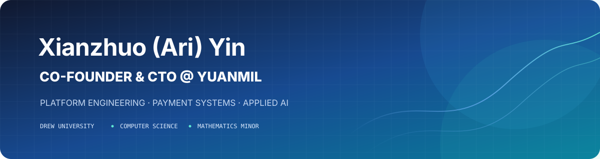
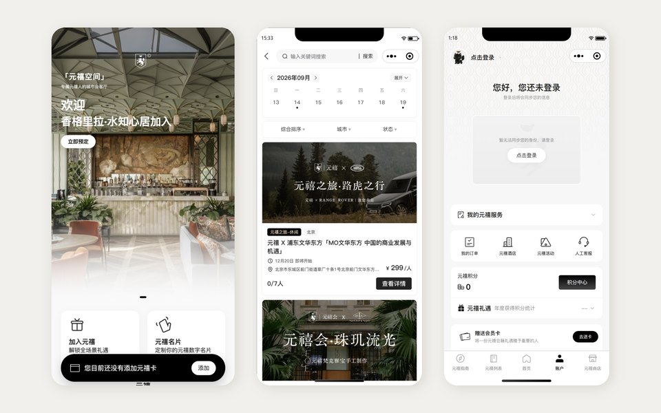
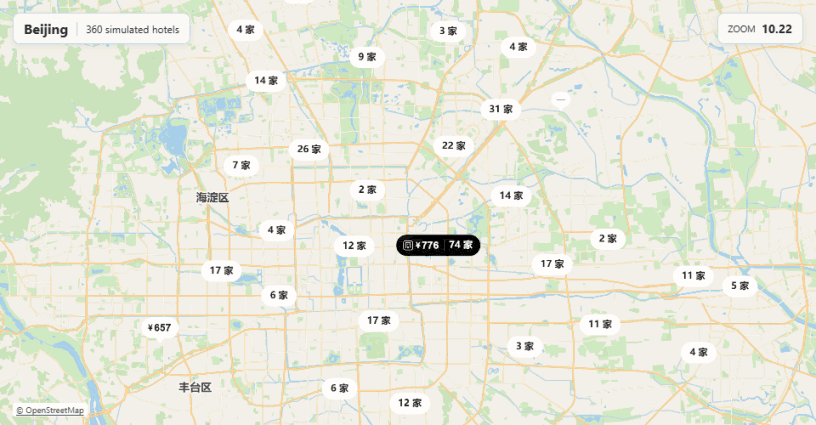
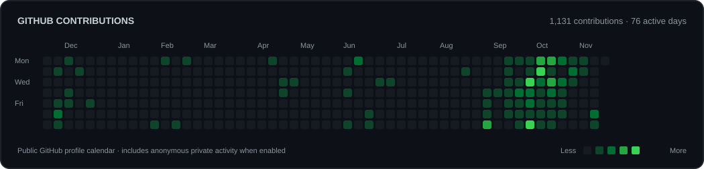

  
  

    
    
    
  

I lead technical direction and build software hands-on across multi-surface products, payment infrastructure, and applied AI. My work spans architecture, backend systems, product interfaces, integrations, and engineering delivery.

## 🚀 What I'm Shipping

<table>
  <tr>
    <td width="50%" valign="top">
      
      <h3>YuanMil OS · 元禧</h3>
      
<strong>Hospitality platform · iOS · WeChat Mini Program · Merchant &amp; Operations Systems</strong>

      
A multi-surface hospitality platform connecting member experiences, merchant workflows, operations tools, hotel services, and shared backend systems.

      
<strong>My scope:</strong> Co-Founder &amp; CTO — technical direction, platform architecture, payment infrastructure, AI integrations, and engineering delivery.

      

        
        
        
      

      
Vue 3 · uni-app · React · Java · Spring Boot · Redis/Lua · MCP

    </td>
    <td width="50%" valign="top">
      
      <h3>SakuraMeter</h3>
      
<strong>Chrome extension · ChatGPT &amp; Codex productivity</strong>

      
Tracks ChatGPT activity with a heatmap and usage trends, shows available Codex quota windows and personal reset times, and includes Side Chat plus an experimental browser Agent.

      
Also surfaces third-party public reset forecasts as experimental signals—not official OpenAI predictions.

      

        
        
        
      

      
TypeScript · Chrome Extension APIs · Browser automation · Local-first data

    </td>
  </tr>
</table>

### Smooth Hotel Map Zoom

Built a MapLibre interaction demo with continuous zoom, animated cluster transitions, and per-frame marker collision checks. The recording uses 360 simulated hotel locations across Beijing.

[Live demo](https://yinl-k.github.io/hotel-map-smooth-zoom/) · [Source](https://github.com/YinL-k/hotel-map-smooth-zoom)

## Co-Founder & CTO · Engineering Leadership

### YuanMil (元禧) · Co-Founder & Chief Technology Officer
*Aug–Nov 2026*

As Co-Founder & CTO, I lead technical direction and remain hands-on across a hospitality platform that includes a member-facing app, WeChat Mini Program, merchant/business app, operations center, hotel console, public website, and shared Java backend.

**Technical ownership**

- **Platform architecture:** Connect product surfaces and shared services across Vue 3 / uni-app / TypeScript clients, React operations tools, Java / Spring Boot APIs, and Redis-backed asynchronous workflows.
- **Payment infrastructure:** Designed gateway and merchant-account routing, account-version snapshots, callback/query verification, idempotency, persistent execution records, and recovery jobs across collection, refunds, and payout workflows.
- **AI & MCP integrations:** Built LLM intent understanding and structured tool selection. Integrated a 20-tool Xiaohongshu MCP service with Redis-serialized execution, task tracking, and media handling; added OAuth 2.0 / PKCE authorization, scoped permissions, audit trails, and revocation.
- **Engineering delivery:** Coordinate cross-module implementation, regression testing, release checks, and deployment documentation.

**Selected implementation work**

- [Payment gateway, transaction verification & recovery — PR #59](https://github.com/hanxiangli666/yuanxihui/pull/59)
- [WeChat commission withdrawal backend — PR #62](https://github.com/hanxiangli666/yuanxihui/pull/62)
- [Merchant app withdrawal and receipt flow — PR #64](https://github.com/hanxiangli666/yuanxihui/pull/64)
- [Xiaohongshu MCP integration — PR #70](https://github.com/hanxiangli666/yuanxihui/pull/70)
- [OAuth 2.0 / PKCE, scoped access and audit — PR #72](https://github.com/hanxiangli666/yuanxihui/pull/72)

**Validation evidence:** The payout workstream included 2,458 passing backend tests and 59 passing frontend regression tests, plus TypeScript type-checking and a test Mini Program build. Payment-channel HTTP responses were simulated in automated tests; these results do not claim real-money transaction or WeChat-device end-to-end verification. MCP deployment and live account authorization are separate release checks.

[Read the YuanMil engineering case study](docs/yuanmil-engineering-overview.md)

## Applied ML Research

### DiscoveryHub · Drew Summer Science Institute (DSSI)
*Summer 2026 · Semantic retrieval & embedding fine-tuning*

Built the retrieval fine-tuning pipeline for matching pharma-side research-interest queries with university technology-transfer listings and patent records.

- Unified **26,648 usable records**: 6,671 AUTM/TTO listings, 9,977 ClinicalTrials.gov records, and 10,000 USPTO patent records.
- Prepared **10,006 evaluation anchors**, query-document pairs, corpus files, relevance labels, and hard negatives.
- Fine-tuned and evaluated **Qwen3-Embedding-0.6B** and **multilingual-e5-large**.

| Model | Recall@10: baseline → tuned | MRR@10: baseline → tuned | Median rank |
|---|---:|---:|---:|
| Qwen3-Embedding-0.6B | 54.3% → **67.3%** | 0.359 → **0.447** | 7 → **3** |
| multilingual-e5-large | 37.1% → **62.3%** | 0.238 → **0.406** | 42 → **4** |

*Data limitation: ClinicalTrials.gov records served as proxy query-side research-interest text; they are not direct statements of companies' open-innovation priorities. Research repository and model artifacts are private.*

## Selected Projects

- **[Google Skills Learning Agent](https://github.com/YinL-k/google-skills-learning-agent)** — guarded browser automation for reading course/lab pages, extracting visible state, classifying action risk, validating safe next steps, and maintaining learning notes. It deliberately does not complete assessments or bypass platform restrictions.
- **[Web Launch Console](https://github.com/YinL-k/web-launch-console)** — Windows PowerShell/WPF control panel for hosting web apps, managing process trees, running health checks, viewing logs, and optionally creating Cloudflare Quick Tunnels.
- **[Identity V Desktop Pets](https://github.com/YinL-k/identity-v-desktop-pets)** — downloadable animated desktop-pet packs with v2 sprite sheets, 9 action groups, and 16 gaze directions.
- **[Pixiv Bookmark Random](https://github.com/YinL-k/Pixiv-Bookmark-Random)** — Manifest V3 extension with background buffering, image preloading, SPA route support, tag context, and recent-item de-duplication.
- **[Interactive Vector Fields](https://github.com/YinL-k/vector-fields-project)** — interactive 2D/3D vector addition and vector-field particle visualizations. [Live demos](https://yinl-k.github.io/vector-fields-project/).
- **[Synchronized Scrolling Reader](https://github.com/YinL-k/synchronized-scrolling-reader)** — self-contained two-pane file reader with synchronized scrolling, syntax highlighting, local file loading, and theme controls.

## Open-Source Contributions

**Merged**

- **[Gulliver #23](https://github.com/laaielichter/Gulliver/pull/23)** — added SQL warning GV016 for ORDER BY RANDOM() / RAND() sampling patterns, with regression coverage across database dialects.
- **[NAGI BENCH #22](https://github.com/nagi-studio/nagi-bench/pull/22)** — contributed a GPT-5.4 / Codex CLI skeleton-watch benchmark artifact and registry entry.
- **[Pixiv-Shaft #1309](https://github.com/CeuiLiSA/Pixiv-Shaft/pull/1309) · [#1310](https://github.com/CeuiLiSA/Pixiv-Shaft/pull/1310)** — fixed Unicode code-point-safe filename truncation and preserved legacy one-based page-number semantics.
- **[whyfull #19](https://github.com/amlaban65/whyfull/pull/19)** — added repeatable --exclude paths to full scans, including reporting and regression tests.

**Open PRs · Under review**

- **[OpenAI simple-evals #134](https://github.com/openai/simple-evals/pull/134)** — fixed undefined HealthBench meta-evaluation scores for single-class predictions; added regression tests for evaluation and report paths.
- **[OpenAI simple-evals #135](https://github.com/openai/simple-evals/pull/135)** — preserved negative signs when parsing MGSM numeric answers; added regression coverage across all 11 language prefixes.

## Toolbox

**Languages:** TypeScript · JavaScript · Python · Java · Kotlin · SQL · HTML · CSS · PowerShell

**Frameworks & platforms:** React · Vue 3 · Spring Boot · Node.js · Chrome Extension APIs · Three.js · WPF · MySQL · Redis/Lua

**AI & systems:** LLM tool orchestration · MCP · OAuth 2.0 / PKCE · Embedding fine-tuning · Semantic retrieval · Payment gateways · Idempotency & recovery

## GitHub Activity

Profile metrics are updated by <a href=".github/workflows/profile-metrics.yml">GitHub Actions</a>.

---

**Building reliable products and intelligent systems—from platform architecture and payments to applied AI.**

<a href="https://github.com/YinL-k?tab=repositories">Explore all repositories</a>

