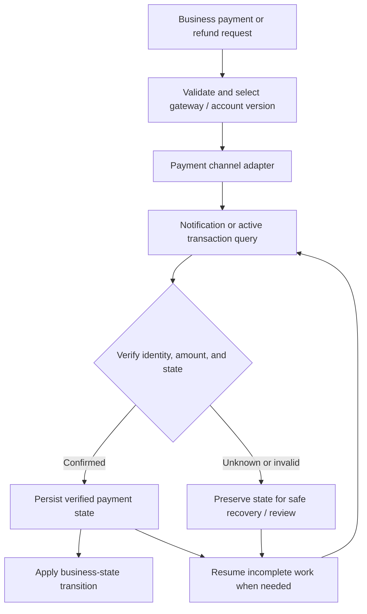
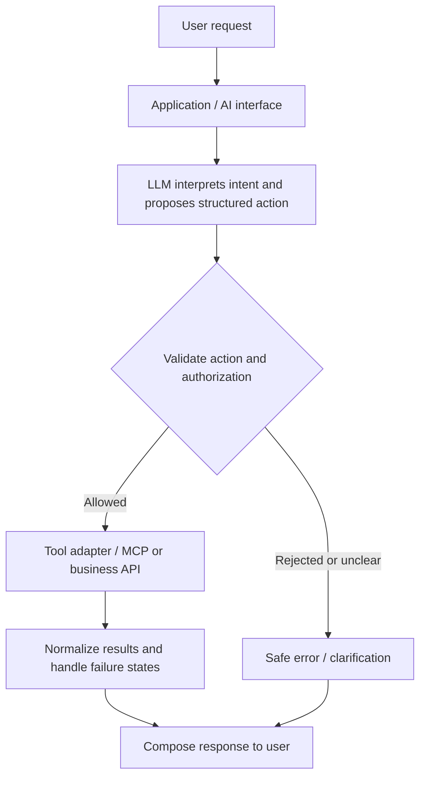

# YuanMil (元禧) — Engineering Experience

> Public, high-level portfolio case study · Aug–Nov 2026 · Early founding team

## Context and role

I worked with YuanMil's early founding team across full-stack engineering, **payment-system architecture**, product design, AI integrations, and operational workflows. The work spanned merchant-facing applications, administration interfaces, business APIs, payment and settlement workflows, and AI-assisted experiences. My role was cross-functional: translating product needs into interface, service, and integration work.

**Scope note:** This is an experience summary, not a claim that every component was released or operated in production. The company source repositories and internal documents are private.

## Engineering areas

| Area | Work and engineering concerns |
| --- | --- |
| **Full-stack product delivery** | Vue 3 / uni-app / TypeScript merchant interfaces, React administration views, and Java / Spring services; business workflows for merchants, stores, members, and orders. |
| **Payment architecture & implementation** | Designed the Java / Spring payment architecture and implemented gateway/routing abstractions for collection and refunds, transaction and callback verification, persisted execution states, idempotency/concurrency safeguards, and recovery flows; also built WeChat commission-payout and unified platform-collection workflows. |
| **AI tool integration** | LLM-assisted intent understanding and structured tool selection, followed by application-side validation and backend or MCP tool execution. |
| **Access and authorization** | OAuth 2.0 with PKCE, scoped access controls, resource isolation, token lifecycle handling, and auditability in integration work. |
| **Async and failure handling** | Queueing and serialized task execution with Redis/Lua, timeout and recovery paths, and validation around business-state changes. |
| **Product and reliability** | Interface design, cross-module coordination, regression checks, preflight documentation, and explicit separation of test evidence from production status. |

## Payment and settlement architecture

**My contribution:** I designed and implemented YuanMil's payment architecture in Java / Spring with MySQL-backed transaction and execution records. This was architecture and engineering work—not merely connecting a checkout button to a payment API.

- **Gateway abstraction and routing:** Separated business payment requests from channel adapters and used payment-account identity/configuration snapshots to keep retries, queries, and refunds associated with the original account.
- **State integrity and recovery:** Designed checks for payment notifications and active queries, including order identity, transaction references, merchant/account information, amounts, and currency. Built persistent execution records and recovery paths for interrupted or uncertain outcomes.
- **Concurrency and idempotency:** Accounted for duplicate notifications, repeated requests, transaction boundaries, and failure states to avoid treating unknown channel outcomes as confirmed payments.
- **Settlement-related workflows:** Implemented WeChat commission-withdrawal interfaces and consent/confirmation flows, plus unified platform-collection routing that preserved merchant/distributor earnings records without equating ledger entries with actual transfers.

### Conceptual payment flow

This diagram illustrates the responsibility boundaries of the design; it is **not** a reproduction of internal source code, deployment topology, or production configuration.

**Evidence boundary:** Relevant payment and payout changes were merged with automated/local verification. Those checks do **not** establish successful real WeChat collection, refund, commission transfer, or complete production acceptance. Feature flags, channel credentials, real-money tests, and deployment each require independent verification.
## Illustrative AI-tool integration flow

The diagram below is **conceptual**, showing the type of separation of responsibilities I worked with. It is **not** an exact internal topology or a published production architecture.

### Design principles

- **Models propose; application code decides.** Tool arguments, permissions, and business constraints need validation outside the LLM.
- **Keep access boundaries explicit.** User consent, scopes, and resource ownership are part of an integration's design, not optional UI details.
- **Treat asynchronous work as stateful.** Queues, timeouts, retry decisions, and observable task states affect reliability.
- **Separate implementation, verification, and deployment.** A merged change, a passing test, and a confirmed production rollout are different kinds of evidence.

## Public work demonstrating related skills

- [SakuraMeter](https://github.com/YinL-k/chatgpt-codex-usage-reset-tracker) — released browser extension with analytics, optional Side Chat, and an experimental browser Agent.
- [Google Skills Learning Agent](https://github.com/YinL-k/google-skills-learning-agent) — guarded browser-automation prototype with state extraction and action evaluation.
- [Web Launch Console](https://github.com/YinL-k/web-launch-console) — a tool for managing web services, process lifecycles, health checks, and logs.

## Disclosure and evidence boundaries

This write-up intentionally omits proprietary source code, configuration, infrastructure endpoints, business records, user data, private architecture diagrams, and internal operational metrics. The technologies and work areas describe my contributions, including payment-architecture design and implementation, but do not imply sole ownership of the entire company's platform. Feature readiness and real-world verification varied across components; no blanket claim of production deployment, payment processing success, or business impact is made.

[Back to profile](../README.md)