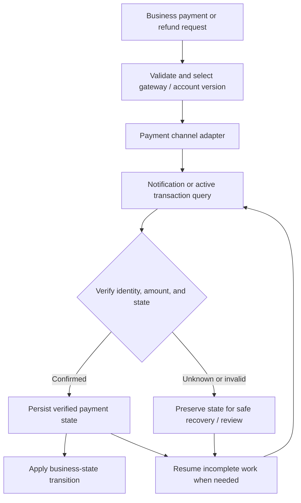
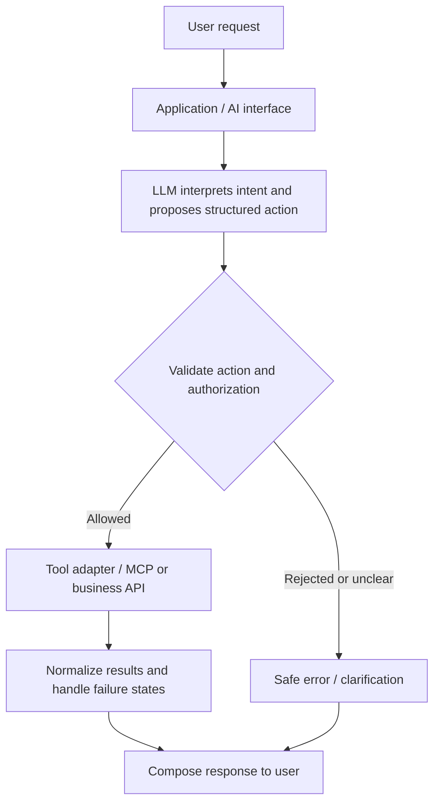

# YuanMil (元禧) — Engineering Case Study

*Early founding team · Aug–Nov 2026*

At YuanMil, I worked on merchant applications, internal operations tools, Java / Spring services, AI integrations, and the payment system. My work included both system architecture and hands-on product development.

## Payment architecture

I designed and implemented the payment architecture for collection, refunds, and settlement-related workflows.

- **Gateway and account routing:** Separated business logic from WeChat payment adapters. Bound transactions to an account/configuration version so retries, queries, callbacks, and refunds use the correct merchant identity.
- **Transaction verification:** Checked callback and query results against order identifiers, transaction references, amounts, currency, and account details before updating business state.
- **Idempotency and recovery:** Used persistent execution records, transaction boundaries, and recovery jobs to handle duplicate notifications, interrupted operations, and uncertain channel responses.
- **Payout and platform collection:** Built WeChat commission-withdrawal flows and unified platform collection while keeping merchant/distributor earnings records separate from confirmed money transfers.

### Payment flow (simplified)

## AI Concierge and integrations

I worked on LLM-based intent understanding and structured tool selection, with application-side argument validation, authorization checks, and backend or MCP tool execution. I also contributed to OAuth 2.0 / PKCE integration and scoped access controls.

### Tool-calling flow (simplified)

## Full-stack and product work

- **Merchant and operations applications:** Vue 3 / uni-app / TypeScript merchant interfaces, React administration tools, and Java / Spring business APIs.
- **Business workflows:** Merchant/store operations, orders, member/distributor experiences, and related backend integrations.
- **Asynchronous work:** Redis/Lua-based serialization and queue handling, with timeout and failure-recovery considerations.
- **Product delivery:** Interface design, cross-module coordination, regression tests, and deployment documentation.

## Scope and verification

Payment-related changes were merged and tested using automated checks and simulated channel responses; those tests did not establish successful end-to-end real-money WeChat processing. Company source code, credentials, and internal business data remain private.

[Back to profile](../README.md)
